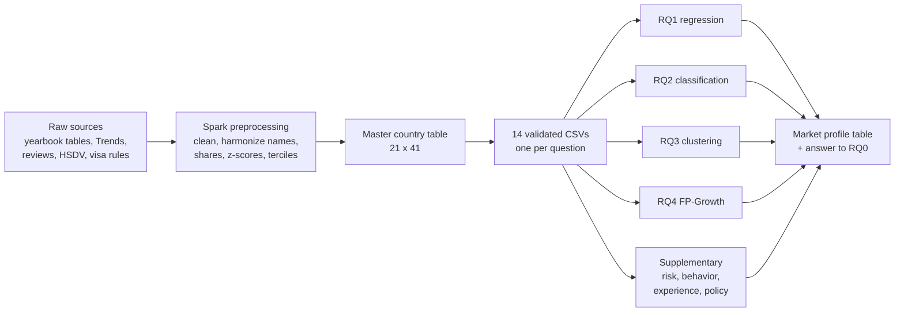
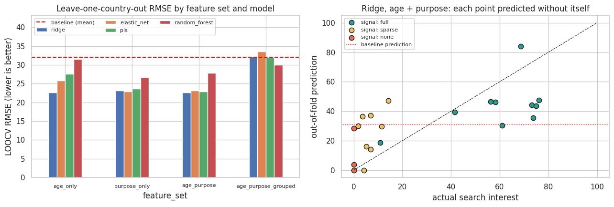
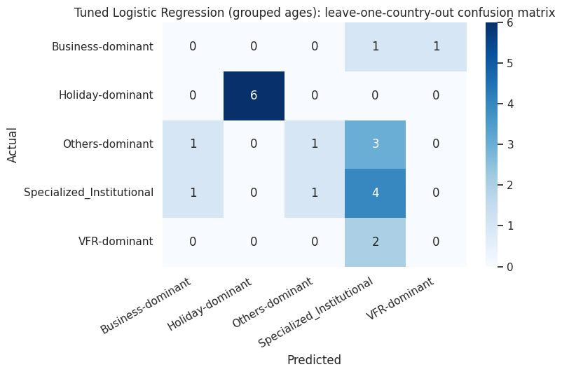
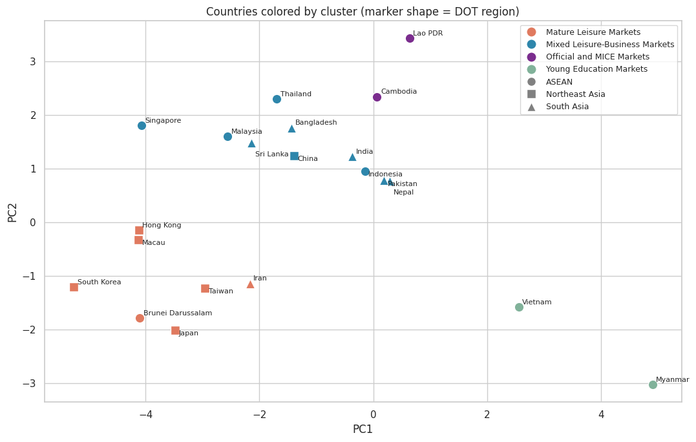
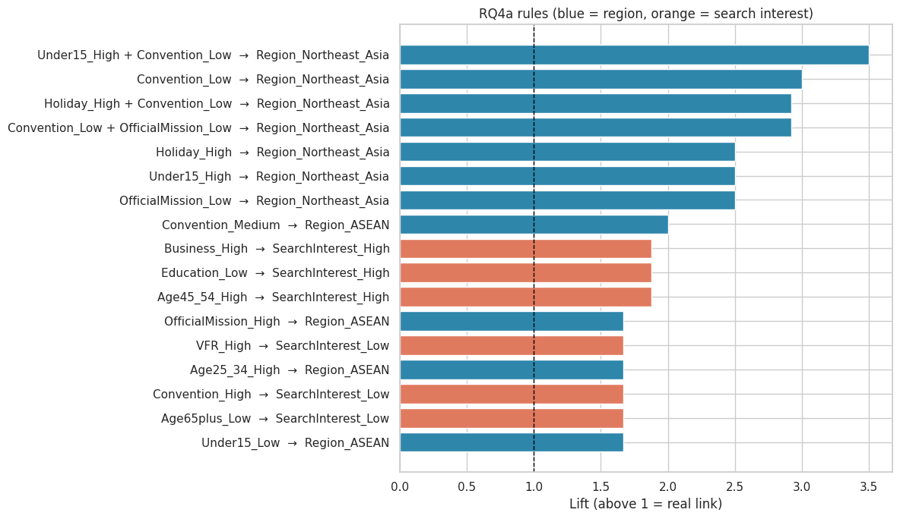
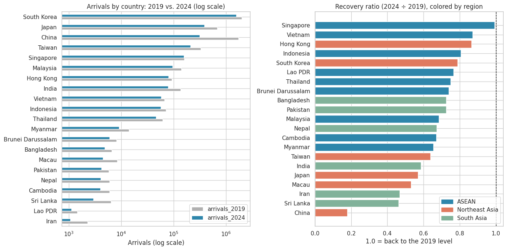
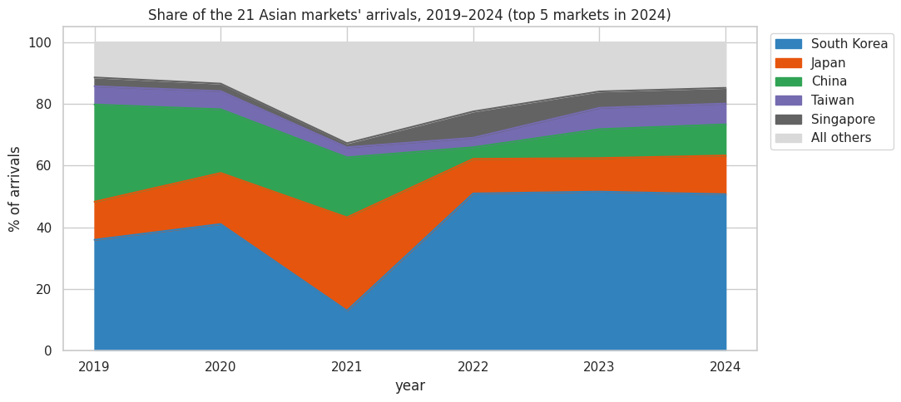

# LakbAI: Profiling Asian Tourist Markets in the Philippines with PySpark

**Who visits the Philippines from Asia, why they travel, how interested they are before they come, and how dependent the country has become on a few markets: a Big Data profile of 21 Asian source markets.**

*LakbAI: A PySpark-Based Profiling and Uncovering of Market Intelligence from Asian Tourist Behavior in the Philippines.* Final project for **DS 011 Big Data Analytics** at the Technological Institute of the Philippines, Quezon City (1st semester, SY 2026-2027), aligned with SDG Targets 8.9 (sustainable tourism) and 12.b (monitoring sustainable tourism).

**Key findings**

- **Markets differ more by who travels and why than by region.** K-Means finds four visitor personas that cut across the Department of Tourism's ASEAN / Northeast Asia / South Asia groupings (purity 0.67).
- **Demand is dangerously concentrated.** South Korea alone supplied 50.7% of Asian arrivals in 2024 (HHI 2,937, "highly concentrated"), up from 36.0% in 2019, while China fell from 31.5% to 10.1%. No market is back to its 2019 level.
- **Traveler mix predicts online interest.** Ridge regression on age and purpose shares predicts Google search interest with **29% less error** than a baseline (RMSE 22.65 vs 31.96, permutation p ≤ 0.01), confirmed in Spark MLlib. Business-heavy and 45-54-heavy markets search the most.
- **Age alone is a weak guide to travel purpose.** Logistic Regression reaches **52.4%** accuracy against a 28.6% baseline (p = 0.01): it always spots holiday markets but cannot identify business or family-visit markets, so purpose data cannot be replaced.

## Contents

- [In plain words](#in-plain-words)
- [Problem statement](#problem-statement)
- [Research questions](#research-questions)
- [Data](#data)
- [System architecture](#system-architecture)
- [Methods and evaluation](#methods-and-evaluation)
- [Results](#results)
- [Recommendations](#recommendations)
- [Repository structure](#repository-structure)
- [Run the notebook](#run-the-notebook)
- [Limitations and future work](#limitations-and-future-work)
- [Team](#team)
- [Glossary](#glossary)
- [References](#references)

---

## In plain words

Most foreign tourists in the Philippines come from Asia, but the official numbers only say how many come from each country. I combined those numbers with who the travelers are (age), why they come (holiday, business, family, study), how often people in each country search Google for Philippine travel, and what visitors write in reviews. Using Apache Spark, a tool built for large data, I found four kinds of visitor markets that do not match the usual "ASEAN / East Asia / South Asia" grouping, and showed that the country depends heavily on South Korea. That points to marketing by visitor type instead of by region, and to growing other markets.

## Problem statement

Asian markets supply most of the Philippines' foreign visitors (67.9% in 2019, 53.6% in 2024). The Department of Tourism (DOT) publishes arrivals by country, age group and purpose, but those tables only say *how many* visitors arrive. There is no consolidated, data-driven profile that connects who travels from each market and why with how interested they are before visiting, what they experience after arriving, and how concentrated demand has become. Planning and promotion are therefore organized by geographic region, even though markets in the same region can behave very differently.

## Research questions

| RQ | Question | Technique |
|---|---|---|
| RQ1 | How well can a market's relative Google search interest in Philippine travel be predicted from its age and purpose composition? RQ1a: which matters more, age or purpose? | Regression |
| RQ2 | Can a market's dominant purpose segment be predicted from its age composition alone? RQ2a: which age groups distinguish each segment? | Classification |
| RQ3 | What visitor personas emerge when markets are clustered by age and purpose? RQ3a: do they match DOT's regions? | Clustering |
| RQ4 | Which age, purpose, region and search-interest levels occur together? RQ4a: do age-purpose combinations concentrate in particular regions or search levels? | Association rule mining |
| RQ0 | What do the four techniques together reveal, and how should that shape sustainable, market-specific tourism planning? | Synthesis |

**Scope:** 21 Asian markets in DOT's groupings: ASEAN (Brunei, Cambodia, Indonesia, Lao PDR, Malaysia, Myanmar, Singapore, Thailand, Vietnam), Northeast Asia (China, Hong Kong, Japan, Macau, South Korea, Taiwan) and South Asia (Bangladesh, India, Iran, Nepal, Pakistan, Sri Lanka). The models use 2024 country-level data, because the yearbook breaks age and purpose down by country for 2024 only. The unit of analysis is the market, not the individual traveler.

## Data

| Dataset | Source | Coverage | Used in |
|---|---|---|---|
| DOT Table 8.1: visitor arrivals by country | Philippine Statistical Yearbook 2025 | 21 countries, 2019-2024 | EDA, recovery, risk |
| DOT Table 8.2: arrivals by mode (air/sea) | PSY 2025 | 2022-2024 | EDA |
| DOT Table 8.3: air arrivals by age group | PSY 2025 | By country, 2024 | RQ1-RQ4 |
| DOT Table 8.4: air arrivals by purpose | PSY 2025 | By country, 2024 | RQ1-RQ4 |
| DOT Table 8.5: spending and length of stay | PSY 2025 | Yearly 2003-2024; monthly 2024 | Visitor behavior |
| DOT Table 8.6: NCR hotel occupancy | PSY 2025 | 2000-2023 | Risk |
| Google Trends search interest | Google Trends (Philippines, Travel category) | Weekly 2024, 21 countries | RQ1, RQ4 |
| Google Local reviews | UCSD Google Local dataset | 773 reviews: Manila, Cebu, Boracay, Palawan, Bohol | Visitor experience |
| Household Survey on Domestic Visitors | PSA | 2022 | Visitor behavior |
| Entry requirements (visa status) | Department of Foreign Affairs e-Visa site | 2024 | Policy context |
| Seasonal events | Compiled 2024 event calendar | 12 months | Risk (seasonality) |

## System architecture

Everything runs in one PySpark notebook on Google Colab, with the data in Google Drive. Spark does the cleaning, joining and modeling; pandas and matplotlib only draw charts from small, already-aggregated tables. The notebook has six stages:



**Preprocessing highlights**

- The yearbook tables are report-style (titles, blank rows, merged headers, national and country blocks mixed), so they are read without headers and columns are selected by position.
- Country names are harmonized ("China (PROC)", "Hong Kong - SAR") so every source joins on one key; thousands separators and dashes are cleaned; always-empty purpose columns are dropped.
- Arrivals are reshaped wide to long with Spark's `stack` (126 country-years), with market share, year-on-year change and log growth from window functions.
- **Engineered features:** age and purpose shares (so large and small markets compare fairly), grouped age bands, recovery ratio (2024 ÷ 2019 arrivals), a search-signal level (full, sparse or none), a China flag (Google is blocked there), and spending per trip.
- **RQ2 labels:** labeling each market by its largest purpose fails, because holiday is the largest almost everywhere. Instead each purpose share is turned into a z-score across markets, and the market takes its most *distinctive* purpose: Holiday-dominant (6), Specialized/Institutional (6), Others-dominant (5), Business-dominant (2) and VFR-dominant (2).
- **RQ4 baskets:** each of the 17 shares is split into terciles with exact percentiles (7 countries per level), so every market becomes a basket of 19 items, for example `Region_ASEAN`, `Under15_High`, `Holiday_Low`, `SearchInterest_High`.
- Every prepared dataset is validated against reference files before it is saved.

## Methods and evaluation

With only 21 markets, every model is judged with **leave-one-country-out cross-validation** (each country predicted by a model trained on the other 20, with tuning nested inside) and against a baseline.

| RQ | Models | Evaluation |
|---|---|---|
| RQ1 | Ridge (main), Elastic Net, PLS, Random Forest, on 4 feature sets (16 setups); Ridge refit in **Spark MLlib** (`LinearRegression`, `elasticNetParam=0`, `CrossValidator`) | RMSE, MAE, R², Spearman ρ; mean baseline; 500-run permutation test; 20 repeated 5-fold splits; sensitivity without China and on full-signal countries; 1,000-resample paired bootstrap |
| RQ2 | Spark MLlib Logistic Regression (tuned with `CrossValidator`), Decision Tree, Random Forest, Multilayer Perceptron; hard and soft voting | Accuracy, macro F1, balanced accuracy; largest-class baseline; 100-run permutation test |
| RQ3 | Spark MLlib K-Means and Bisecting K-Means, k = 2 to 8, two feature sets, 5 seeds each (140 models) | WSSSE (elbow), silhouette, purity against DOT regions and RQ2 segments |
| RQ4 | Spark MLlib FP-Growth, grid over minSupport {0.15, 0.20, 0.25} and minConfidence {0.6, 0.7, 0.8} | Support, confidence, lift |
| Supplementary | Spark aggregations | HHI and "equivalent markets", recovery and volatility, occupancy gap, keyword-based aspect satisfaction |

## Results

### RQ1 · Search interest (regression)

| Model (feature set) | RMSE | MAE | R² | Spearman ρ | Gain vs baseline |
|---|---|---|---|---|---|
| **Ridge (age + purpose)** | **22.65** | 19.12 | **0.45** | 0.74 | **29.1%** |
| Ridge (age only) | 22.69 | 17.73 | 0.44 | 0.66 | 29.0% |
| PLS (age + purpose) | 22.85 | 18.74 | 0.44 | 0.74 | 28.5% |
| Elastic Net (purpose only) | 22.93 | 19.51 | 0.43 | 0.84 | 28.3% |
| Random Forest (age + purpose) | 27.85 | 25.27 | 0.16 | 0.42 | 12.9% |
| Baseline (mean) | 31.96 | 30.55 | | | |

- The signal is real (permutation p ≤ 0.01), stable across random splits, and confirmed by the Spark MLlib refit (RMSE 22.20, ρ 0.77).
- It mainly separates strong-interest from weak-interest markets: among the 10 countries with full-year search data, no model beats the baseline.
- **Drivers** (sign-stable in at least 90% of bootstrap resamples): business share and the 45-54 age share raise interest; VFR, convention and official-mission shares lower it.
- **RQ1a:** on error alone, age and purpose cannot be separated, but purpose ranks markets better (ρ 0.81 vs 0.66) and holds up better without China.



### RQ2 · Purpose segment from age (classification)

| Model (4 grouped age shares) | Accuracy | Macro F1 | Balanced accuracy |
|---|---|---|---|
| **Tuned Logistic Regression** | **52.4%** | **0.357** | **0.373** |
| Random Forest | 47.6% | 0.271 | 0.333 |
| Hard voting | 47.6% | 0.285 | 0.333 |
| Multilayer Perceptron | 42.9% | 0.327 | 0.313 |
| Decision Tree | 28.6% | 0.187 | 0.200 |
| Baseline (largest class) | 28.6% | 0.089 | 0.200 |

All six Holiday-dominant markets are identified; the two Business-dominant and two VFR-dominant markets never are.



 **RQ2a:** children and seniors mark holiday markets, young adults (15-34) mark specialized markets (study, training, official trips), and 35-54 travelers mark business markets.

### RQ3 · Visitor personas (clustering)

Final model: K-Means, k = 4, on 15 shares (two near-constant features dropped), silhouette **0.488**.

| Persona | Markets | Profile | Share of 2024 arrivals |
|---|---|---|---|
| **Mature Leisure** | Brunei, Hong Kong, Iran, Japan, Macau, South Korea, Taiwan | 71% holiday; most travelers 55+ and most children | 73.0% |
| **Mixed Leisure-Business** | Bangladesh, China, India, Indonesia, Malaysia, Nepal, Pakistan, Singapore, Sri Lanka, Thailand | 45% holiday; highest business share (19%) | 24.7% |
| **Official and MICE** | Cambodia, Lao PDR | Conventions 22%, official missions 11%, education 10% | 0.2% |
| **Young Education** | Myanmar, Vietnam | Two in three aged 20-34; highest education share (22%) | 2.2% |

**RQ3a:** purity against DOT's regions is only 0.67: ASEAN splits across all four personas, China joins the mixed group, and Brunei and Iran join Mature Leisure.



### RQ4 · Association rules (FP-Growth)

At minSupport 0.20 (at least 5 countries) and minConfidence 0.70: 156 frequent itemsets and **220 rules**, all with lift above 1 (highest 3.5).

| Rule (IF → THEN) | Confidence | Lift | Where it holds |
|---|---|---|---|
| Under15_High + Convention_Low → Northeast Asia | 1.00 | 3.50 | China, Japan, South Korea, Macau, Taiwan |
| Convention_Low → Northeast Asia | 0.86 | 3.00 | China, Hong Kong, Japan, South Korea, Macau, Taiwan |
| Convention_Medium → ASEAN | 0.86 | 2.00 | Brunei, Indonesia, Malaysia, Myanmar, Singapore, Vietnam |
| Business_High → SearchInterest_High | 0.71 | 1.88 | Malaysia, Singapore, Thailand, Hong Kong, India |
| Age45_54_High → SearchInterest_High | 0.71 | 1.88 | Malaysia, Singapore, Thailand, Hong Kong, South Korea |
| VFR_High → SearchInterest_Low | 0.71 | 1.67 | Brunei, Macau, Nepal, Pakistan, Sri Lanka |

Family-leisure traits concentrate in Northeast Asia, official and young working-age traits in ASEAN, and business traits in high-search markets, matching RQ1 and RQ3.



### Supplementary findings

<p>
  
  
</p>


- **Concentration risk:** HHI rose from 2,502 (2019) to 2,937 (2024), the equivalent of only 3.4 equal-sized markets. Recovery ranges from 0.18 (China) to 0.99 (Singapore), median 0.68.
- **Spare capacity:** Metro Manila hotel occupancy was 61.8% in 2022-2023, about 11 points below its 73.1% peak (2007): demand, not rooms, is the constraint.
- **Visitor behavior:** since reopening, foreign visitors stay longer (11.8 nights) and spend more per trip (USD 1,976) than in 2019 (9.4 nights, USD 1,203).
- **Visitor experience** (570 English reviews): room comfort (3.64) and cleanliness (3.66) score lowest; location (3.92), staff and food (3.89) highest.
- **Visa policy:** the 15 visa-free markets supplied 86.9% of arrivals, with a median recovery of 0.74, against 0.53 for the 6 visa-required markets. India stands out: high search interest (73.8) but only 0.59 recovery.

## Recommendations

- **DOT and the Tourism Promotions Board:** plan campaigns by persona rather than region; grow markets beyond South Korea; prioritize recovering Japan and China.
- **Digital promotion:** focus online campaigns on high-search markets (Singapore, Malaysia, Thailand, Hong Kong, South Korea); reach low-search markets through event organizers, embassies and partners.
- **By persona:** family- and senior-friendly beach and resort products for Mature Leisure; "bleisure" packages for Mixed Leisure-Business; regional meetings and trainings for Cambodia and Lao PDR; study and training programs for Myanmar and Vietnam.
- **Hotels and local governments:** prioritize room upkeep and cleanliness; align Boracay's prices with visitor expectations.
- **Policy makers:** track arrivals from India (visa-free since June 2025) and China (14-day visa-free entry since January 2026).
- **DOT and PSA:** keep publishing purpose-by-country tables, which age data cannot replace.

## Repository structure

```text
├── notebooks/
│   └── lakbai_pyspark_analysis.ipynb   the whole study: setup, preprocessing, EDA, RQ1-RQ4,
│                                       supplementary analyses and synthesis, saved with every output
├── data/                               same folder names as the team's Google Drive "Datasets" folder
│   ├── Dept of Tourism Tables/         DOT tables 8.1-8.6 from the 2025 Philippine Statistical Yearbook
│   ├── Regression/                     Google Trends search interest by country
│   ├── Clustering and Classification/  reference file used to validate the prepared features
│   ├── Association Rule Mining/        reference file used to validate the RQ4 baskets
│   ├── Supplementary/                  visa rules, 2022 domestic visitor survey, seasonal demand, reviews
│   └── Preprocessed/                   the 14 datasets the notebook writes
├── docs/
│   ├── lakbai-paper.pdf                the project paper (ACM format; emails removed)
│   └── figures/                        charts used in this README, exported from the notebook
├── requirements.txt
└── README.md
```

## Run the notebook

The notebook keeps every output from its final run, so GitHub shows all tables and charts without running anything. To run it yourself:

**In Google Colab:** upload this repository's `data/` folder to your Google Drive, open `notebooks/lakbai_pyspark_analysis.ipynb` in Colab, set `BASE` in the "Starting Spark and Setting Folder Paths" cell to that folder, and select **Runtime > Run all**. The notebook installs PySpark and asks to connect your Drive.

**On your own computer:** the notebook detects that it is not in Colab, skips the Drive step and reads `../data`. Install Java 17 or newer (Spark needs it) and Python 3.11 to 3.13, then:

```bash
git clone https://github.com/james-kalaw/lakbai.git
cd lakbai
python -m venv .venv
```

```bash
source .venv/bin/activate          # Windows PowerShell: .\.venv\Scripts\Activate.ps1
pip install -r requirements.txt
jupyter lab notebooks/lakbai_pyspark_analysis.ipynb
```

Run all cells from the top. The first setup cell prints `OK` or `MISSING` for each data folder.

**Checked:** the whole notebook was re-run from a fresh copy of this repository (no Google Drive) and finished without errors. Every headline number matches the paper: Ridge RMSE 22.65 against a 31.96 baseline, silhouette 0.488, 220 association rules, HHI 2,937, purity 0.67. The only differences are cosmetic: Spark progress bars and the order of some rows in printed tables.

## Limitations and future work

- **21 rows.** One analysis year and 21 markets keep every model small; results describe patterns across markets, not individual travelers, and each association rule rests on 5 or 6 countries.
- **Search interest is self-normalized** per country and partly missing (3 markets score 0; Google is blocked in China), so it measures relative, not absolute, interest.
- **Reviews are old** (mostly 2012-2014) and keyword-based, so they reflect past experiences.
- **Future work:** a multi-year country panel from earlier yearbooks; flight connectivity, distance, income, diaspora and marketing spend as features; non-Asian markets; multilingual topic and sentiment models for recent reviews; a scheduled monitoring dashboard (SDG 12.b); and measuring the effect of the 2025-2026 visa changes.

## Team

Technological Institute of the Philippines, Quezon City. Professor: Dr. Rosmina Joy Cabauatan.

**James Andre L. Kalaw**: data collection, the Spark preprocessing pipeline, exploratory analysis, the four research questions (regression, classification, clustering and association rules), the supplementary analyses and the notebook.

Course group and paper co-authors: Juliana Ysabel D.C. Detera and Josh Andrei A. Ituralde.

## Glossary

| Term | Meaning |
|---|---|
| Source market | A country that sends tourists to the Philippines |
| PySpark / Spark MLlib | Apache Spark's Python interface and its machine learning library, built to process large data in parallel |
| Leave-one-country-out | Test each country with a model trained on the other 20, so every score is on unseen data |
| Baseline | The simplest possible guess (for example, the average); a model must beat it to be useful |
| Ridge regression | Linear regression that shrinks coefficients, suited to features that overlap |
| Macro F1 | Accuracy measure that treats every class equally, even small ones |
| K-Means, silhouette | A clustering method, and a score of how well separated its groups are (-1 to 1) |
| FP-Growth, support, confidence, lift | Association rule mining: how common a pattern is, how often the rule holds, and how much more often than by chance |
| HHI | Herfindahl-Hirschman Index: market concentration; above 2,500 is highly concentrated |
| VFR, MICE | Visiting friends and relatives; meetings, incentives, conventions and exhibitions |

## References

1. Philippine Statistics Authority. 2025. *2025 Philippine Statistical Yearbook*, Chapter 8: Tourism. https://psa.gov.ph/philippine-statistical-yearbook
2. Philippine Statistics Authority. 2023. *2022 Household Survey on Domestic Visitors*. https://psa.gov.ph
3. Google Trends. https://trends.google.com
4. He, R., Kang, W.-C., and McAuley, J. 2017. Translation-based recommendation. *RecSys '17*. (Google Local reviews dataset)
5. Department of Tourism. 2023. *National Tourism Development Plan 2023-2028*.
6. Zaharia, M., et al. 2016. Apache Spark: A unified engine for big data processing. *Communications of the ACM* 59, 11.
7. Meng, X., et al. 2016. MLlib: Machine learning in Apache Spark. *Journal of Machine Learning Research* 17, 34.
8. Kaufman, L., and Rousseeuw, P. J. 1990. *Finding Groups in Data: An Introduction to Cluster Analysis*. Wiley.
9. U.S. Department of Justice and Federal Trade Commission. 2010. *Horizontal Merger Guidelines* (HHI thresholds).

The full reference list (53 sources) is in [`docs/lakbai-paper.pdf`](docs/lakbai-paper.pdf).
